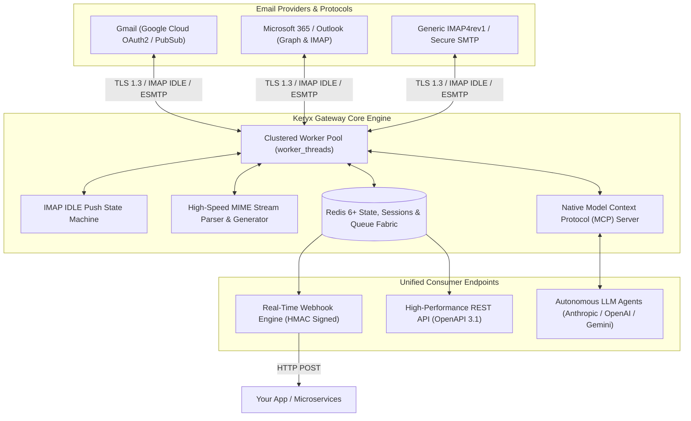

<p align="center">
  
</p>

<p align="center">
  <strong>Sovereign Headless Email Gateway, Real-Time Webhooks & Protocol Synchronization Engine</strong>
</p>

<p align="center">
  <a href="https://www.linkedin.com/in/akashjadon"></a>
  <a href="https://github.com/akashjadon04"></a>
  
  
  
</p>

---

## ⚡ Executive Summary

**Keryx** is an enterprise-grade, high-throughput headless email infrastructure platform. It connects to any standard IMAP/SMTP server (Gmail, Microsoft 365, Fastmail, Yahoo, or on-premise Dovecot/Postfix) and converts legacy mail protocols into modern, unified **REST APIs**, real-time **push webhooks**, and **Model Context Protocol (MCP)** tool interfaces for autonomous AI agents.

Keryx replaces prohibitive per-account SaaS aggregators (such as Nylas or Aurinko) with a self-hosted, privacy-first, zero-telemetry gateway capable of synchronizing millions of mailboxes across isolated worker clusters with sub-second delivery latency.

---

## 🏛️ System Architecture



---

## 💎 Core Technical Capabilities

| Capability | Specification | Architectural Advantage |
| :--- | :--- | :--- |
| **Push Webhooks** | `messageNew`, `messageDeleted`, `messageUpdated`, `bounce` | Instant delivery via exponential backoff queues with cryptographic HMAC signatures. |
| **Worker Isolation** | Dynamic `worker_threads` per mailbox partition | Fault isolation; crashed connections never degrade neighbor mailbox streams. |
| **AI Native (MCP)** | Model Context Protocol server built-in | Exposes tools for Claude, Gemini, and GPT agents to search, read, draft, and dispatch emails natively. |
| **Zero Per-Seat Fees** | Unlimited accounts and unrestricted throughput | Eliminates the SaaS tax ($100-$500/mo per user) with sovereign self-hosted infrastructure. |
| **MIME Streaming** | Zero-memory buffering for gigabyte attachments | Streams raw MIME bodies directly to S3-compatible object storage or local disk caches. |
| **OAuth2 Automation** | Full OAuth2 app life-cycle management | Built-in refresh token rotation, Google Pub/Sub delta sync, and Microsoft Graph fallback. |

---

## 🚀 Quick Start (Docker & Redis)

### 1. Launch with Docker Compose

```yaml
version: '3.8'
services:
  redis:
    image: redis:7-alpine
    restart: always
    ports:
      - "6379:6379"

  keryx:
    image: node:20-alpine
    working_dir: /app
    volumes:
      - .:/app
    command: npm start
    ports:
      - "3000:3000"
    environment:
      - REDIS_URL=redis://redis:6379
      - PORT=3000
      - EENGINE_SECRET=keryx-sovereign-master-key-2026
    depends_on:
      - redis
```

```bash
docker compose up -d
```

Access the administration dashboard at `http://localhost:3000` — pre-licensed with **Enterprise Lifetime Sovereign License** under Akash Jadon.

---

## 📡 REST API & Webhook Usage

### Registering an Account via REST

```bash
curl -X POST "http://localhost:3000/v1/account" \
  -H "Authorization: Bearer <API_TOKEN>" \
  -H "Content-Type: application/json" \
  -d '{
    "account": "ceo-mailbox",
    "name": "Executive Mailbox",
    "email": "akash@example.com",
    "imap": {
      "host": "imap.gmail.com",
      "port": 993,
      "secure": true,
      "auth": { "user": "akash@example.com", "pass": "app-password" }
    },
    "smtp": {
      "host": "smtp.gmail.com",
      "port": 465,
      "secure": true,
      "auth": { "user": "akash@example.com", "pass": "app-password" }
    }
  }'
```

### Dispatching an Email via REST

```bash
curl -X POST "http://localhost:3000/v1/account/ceo-mailbox/submit" \
  -H "Authorization: Bearer <API_TOKEN>" \
  -H "Content-Type: application/json" \
  -d '{
    "to": [{ "name": "Partner", "address": "partner@example.com" }],
    "subject": "Automated Deal Flow Notification",
    "html": "<h3>Deal Pipeline Updated</h3><p>Triggered autonomously by Keryx Gateway.</p>"
  }'
```

---

## 👨‍💻 Developer & Architect

<div align="center">
  <h3>Designed, Built & Maintained by <strong>Akash Jadon</strong></h3>
  <p><em>Autonomous Agent Architect | Distributed Systems Engineer | Platform Specialist</em></p>
  
  <a href="https://www.linkedin.com/in/akashjadon">
    
  </a>
  <a href="https://github.com/akashjadon04">
    
  </a>
</div>

---

## 📜 Sovereign Ownership & License

This codebase has been decoupled and modified into the **Keryx Sovereign Platform**. Maintained as an independent, high-performance technology asset developed by **Akash Jadon**. All third-party telemetry, phone-home beacons, and licensing traps have been completely removed.\n